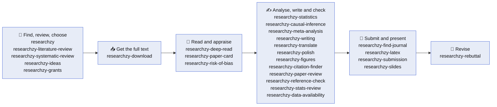

<p align="center">
  <picture>
    <source media="(prefers-color-scheme: dark)" srcset="assets/researchzy-logo-dark.svg">
    
  </picture>
</p>

<h1 align="center">Researchzy Academic Skills</h1>

<p align="center">
  <b>Give your AI agent the skills of a careful researcher — working from real papers.</b><br>
  Find papers among 250 million records, review the literature or run a systematic review,<br>
  test your ideas, read closely, analyse and pool the evidence, write, translate and polish,<br>
  check and submit your paper, present it, and answer the reviewers.
</p>

<p align="center">
  <a href="LICENSE"></a>
  <a href="CHANGELOG.md"></a>
  <a href="#-whats-included"></a>
  <a href="plugins/researchzy/docs/tools.md"></a>
  <a href="#-whats-included"></a>
  <a href="https://agentskills.io/"></a>
  <a href="https://github.com/Researchzy/Researchzy-academic-skills/actions/workflows/tests.yml"></a>
  <a href="#-getting-started"></a>
</p>

---

Researchzy Academic Skills is **twenty-six agent skills for the whole life of a paper**, from choosing the question to answering the reviewers, in five plugins: one that searches real papers and needs a Researchzy account, and four that work on your own files with no account. They follow the open [Agent Skills](https://agentskills.io/) standard, install as plugins in **Claude Code** and **Codex**, and work in any host that supports Agent Skills. These are the same skills that run inside the [Researchzy Agent](https://researchzy.com).

> ⭐ **If these skills save you an afternoon, please [star the repository](https://github.com/Researchzy/Researchzy-academic-skills).** Stars help other researchers find it and tell us which skills to build next.

## ✨ Why Researchzy

- 📚 **Real papers, not invented citations.** Search returns real bibliographic records from about 250 million scholarly papers across arXiv, PubMed and open-access literature. The reading skills never turn metadata into full-text claims or page numbers.
- 🧭 **Reviews you can audit.** A literature review logs every search with its counts, records why each paper was kept or left out, reads the core papers in full, and cites only papers the index returned.
- 🧪 **Systematic reviews whose numbers add up.** A coded protocol, searches logged with their dates and counts, a quoted reason for every exclusion, a calibration sample you screen yourself, and a PRISMA 2020 flow computed from the per-record ledger. Risk of bias is judged with the tool you register, every judgement backed by a quote from the full text, and a meta-analysis declares every conversion and reports heterogeneity and a prediction interval.
- 🔗 **Citations that were read.** For each sentence that needs a source, the citation finder searches with logged queries, reads the abstract or the full text, and offers a paper only with a quote that supports the sentence. When nothing fits, it says so and shows what it searched.
- ✅ **References you can trust.** The reference check tells you which references in a draft are real, which carry another paper's DOI or a wrong author, and which were retracted. It can also check that a cited paper says what your sentence says, with a quote and a page.
- 💡 **Ideas checked before you commit.** Every idea becomes a card that names the result that would refute it. Its novelty is judged from logged searches of real papers, with the closest works named and what differs, and nothing is recommended until the checks are in the record.
- 📝 **Writing that starts from your evidence.** Each claim is tied to one of your results or to a paper and how far it was read; what is missing gets a placeholder, never an invented number. A script checks that numbers agree across abstract, text and tables, and that a revision changed no number or citation.
- 📈 **Figures checked as files.** One script per figure at the venue's width, and a checker that measures the exported PDF: physical size, smallest font at print scale, and whether the colours stay apart for colour-blind readers and in grayscale.
- 🔢 **Numbers that come from your analysis.** The statistics skill chooses the method from the design (paired, repeated, clustered), keeps the analysis script, records every test with its effect size and interval, and checks each number in your Results text against that record.
- 📉 **Causal claims with their assumptions.** Difference-in-differences with staggered adoption, instrumental variables, regression discontinuity, panel, synthetic control and weighting: the estimand and the identifying assumption first, a robust estimator as the headline with the traditional one beside it, the diagnostics each design needs, and no causal verb the evidence does not support.
- 🌐 **Translation and polishing that change nothing else.** Academic translation between Chinese and English with formulas, citations and numbers masked so they cannot change, and language polishing at the level you choose with a reason for every edit; scripts check numbers, citations, terms and the strength of every claim.
- 🧐 **A review before the reviewers.** Claims against evidence, numbers against tables, novelty against real papers; every finding quotes the manuscript and names the smallest fix. No score.
- 🔓 **Full text, the lawful way.** The PDFs Researchzy holds come first, then open-access copies (PMC, Unpaywall, openly licensed publisher PDFs, arXiv), then full text through *your own* Elsevier, Springer Nature or IEEE API keys. Every attempt is recorded in `manifest.json`.
- 🔍 **Reads like a careful colleague.** A close reading works through the key formulas with concrete numbers and marks where the evidence stops. A Paper Card ties every claim to its experiment and ends with testable research ideas.
- 🎯 **Journals chosen from evidence.** A shortlist built from where similar papers and your own references were published, with registry facts that carry their source and date, never an impact factor or a fee from memory.
- 📮 **A submission package that agrees with itself.** Cover letter, title page and declarations from your facts, checked against the limits you paste from the venue's instructions, across documents (grant numbers, ethics IDs, author order) and, for blind review, for anything that names you.
- 🛠️ **LaTeX that builds, untouched.** The build log becomes a short list of real problems; fixes are mechanical and a check confirms that no label, citation, figure or word of content changed. Then a source archive that is rebuilt to prove it compiles.
- 🎤 **Talks and grants from the same evidence.** Slides use the paper's own figures and a script flags any number that is not in the paper. A grant proposal is checked against the call you supply: sections, limits, criteria, aims with fallbacks, and the budget arithmetic.
- ✍️ **From draft to acceptance.** Audit your statistics, draft the Data and Code Availability statement journals ask for, and turn reviewer comments into a point-by-point response, a cover letter and a LaTeX revision package.
- 🧩 **Works where you work.** Plugins for Claude Code and Codex; `npx skills` or `gh skill` for Cursor, Gemini CLI, GitHub Copilot, Antigravity and 40+ other hosts.
- 🔒 **You stay in control.** The skills run in your agent. Researchzy only answers the literature tools, after you sign in and approve their scopes, and you can disconnect at any time.

## 📦 What's Included

### `researchzy` — find and review the literature (needs a Researchzy account)

| Skill | What it does |
|---|---|
| 🔎 [`researchzy`](plugins/researchzy/skills/researchzy/SKILL.md) | **Start here.** Search 250M papers by keywords, title, DOI or arXiv ID; filter by year, field and venue; sort by citations; browse and organize your library; fetch PDFs; hand every other task to the skill that fits<br>**You get:** Real metadata and verified local PDFs |
| 🧭 [`researchzy-literature-review`](plugins/researchzy/skills/researchzy-literature-review/SKILL.md) | A literature review on a topic: confirmed questions, logged searches in five passes, screening with reasons, full-text reading of the core papers, synthesis by theme<br>**You get:** `review.md` with a comparison table and gaps, `papers.csv`, `references.bib` and a search log |
| 💡 [`researchzy-ideas`](plugins/researchzy/skills/researchzy-ideas/SKILL.md) | Develop research ideas: generate them from a topic, an observation or a review's gaps, sharpen one hypothesis, or judge an idea you already have; check novelty with logged searches; gates before ratings<br>**You get:** `ideas.md` with one card per idea, the closest existing papers and what differs, and a novelty log |
| 🔗 [`researchzy-citation-finder`](plugins/researchzy/skills/researchzy-citation-finder/SKILL.md) | Find real papers for the sentences of a draft that need a citation: logged searches per sentence, reading to the depth the claim needs, a verdict with a quote, a narrower wording when the evidence supports less<br>**You get:** A citation map, `new-references.bib`, and the searches tried where nothing was found |
| 🎯 [`researchzy-find-journal`](plugins/researchzy/skills/researchzy-find-journal/SKILL.md) | Choose where to submit: tally where similar papers and your references were published, check each venue in Crossref and DOAJ, and plan the next step after a rejection<br>**You get:** A shortlist with the evidence for each venue, sourced and dated facts, and a list of what to confirm on the venue's site |

The plugin connects nine [MCP tools](plugins/researchzy/docs/tools.md): `search_papers`, `get_paper`, `list_collections`, `create_collection`, `list_library_papers`, `add_paper_to_library`, `get_pdf_download`, `create_pdf_upload` and `get_profile`.

### `researchzy-reading` — read papers (no account)

| Skill | What it does |
|---|---|
| 📥 [`researchzy-download`](plugins/researchzy-reading/skills/researchzy-download/SKILL.md) | Get full text for a list of DOIs or titles from open access or your own publisher API keys<br>**You get:** Verified PDFs or full text, and a `manifest.json` of every attempt |
| 📖 [`researchzy-deep-read`](plugins/researchzy-reading/skills/researchzy-deep-read/SKILL.md) | Close reading of one paper: how the authors got there, which design choices carry the result, the key formulas with real numbers, how far the evidence reaches<br>**You get:** A Markdown long-read |
| 🗂️ [`researchzy-paper-card`](plugins/researchzy-reading/skills/researchzy-paper-card/SKILL.md) | A structured 16-section analysis of one paper: question, method logic, experiment-to-claim evidence, limitations, critique, research ideas<br>**You get:** A source-anchored `paper-card.md` and an audit report |

### `researchzy-manuscript` — prepare, check and revise a manuscript (no account)

| Skill | What it does |
|---|---|
| 📝 [`researchzy-writing`](plugins/researchzy-manuscript/skills/researchzy-writing/SKILL.md) | Plan, draft or revise an empirical paper from your own results: claim ledger, gap report, outline with word budget, evidence-first drafting, meaning-preserving revision<br>**You get:** The ledger, the gaps, the draft, and a check of numbers, placeholders and citation keys |
| 📈 [`researchzy-figures`](plugins/researchzy-manuscript/skills/researchzy-figures/SKILL.md) | Make publication figures from data: profile the data, choose a chart it can support, draw at the venue's column width, export, and check the exported file<br>**You get:** One script per figure, PDF and PNG with a record of what they were made from, and a check of size, fonts and colours |
| 🧐 [`researchzy-paper-review`](plugins/researchzy-manuscript/skills/researchzy-paper-review/SKILL.md) | Review a manuscript the way its reviewers will, or draft a referee report: claims against evidence, numbers against tables, novelty against real papers<br>**You get:** Findings with verified quotes and minimal fixes, and two readiness verdicts; no score |
| 📊 [`researchzy-stats-review`](plugins/researchzy-manuscript/skills/researchzy-stats-review/SKILL.md) | Audit a manuscript's statistical reporting: experimental units, replication, uncertainty, tests, figure statistics<br>**You get:** Issues by severity, a ready-to-paste Statistical analysis section, and questions for the authors |
| 🗄️ [`researchzy-data-availability`](plugins/researchzy-manuscript/skills/researchzy-data-availability/SKILL.md) | Draft or audit Data and Code Availability statements, repository plans and dataset citations<br>**You get:** A ready-to-paste statement, repository and citation actions, and missing-information flags |
| ✅ [`researchzy-reference-check`](plugins/researchzy-manuscript/skills/researchzy-reference-check/SKILL.md) | Check every reference of a manuscript or `.bib` against Crossref, DataCite, arXiv, PubMed and Researchzy: it exists, its DOI is its own, authors and year match, it is not retracted. Optionally check that each cited paper supports the sentence citing it<br>**You get:** A report with a verdict and evidence per reference, a corrected `.bib`, and quotes with pages for checked claims |
| 🔢 [`researchzy-statistics`](plugins/researchzy-manuscript/skills/researchzy-statistics/SKILL.md) | Analyse your own data: a plan before any test, the method from the design, effect sizes with intervals, corrections for multiple tests; sample size and power with a sourced effect size<br>**You get:** A script you keep, `results.json`, and Results and Statistical analysis text checked against it |
| 📉 [`researchzy-causal-inference`](plugins/researchzy-manuscript/skills/researchzy-causal-inference/SKILL.md) | Estimate a causal effect from observational data: difference-in-differences with staggered adoption and event studies, instrumental variables, regression discontinuity, panel, synthetic control or weighting, with the estimand and assumption written first and the diagnostics each design needs<br>**You get:** A probe of the data and a route, a script you keep, `results.json`, a robustness table, and text checked against it |
| 📮 [`researchzy-submission`](plugins/researchzy-manuscript/skills/researchzy-submission/SKILL.md) | Prepare the submission package from your facts and check it against the venue's instructions you supply<br>**You get:** Cover letter, title page, highlights, declarations, and a check of limits, required statements, consistency and anonymity |
| 🛠️ [`researchzy-latex`](plugins/researchzy-manuscript/skills/researchzy-latex/SKILL.md) | Get a LaTeX paper to build cleanly without changing its content, move it into a venue's template, and pack the source<br>**You get:** A short problem list from the log, a content check before and after fixes, a tested source archive, and PDF facts |
| 🎤 [`researchzy-slides`](plugins/researchzy-manuscript/skills/researchzy-slides/SKILL.md) | Turn a paper into a talk or a journal-club presentation sized to the time, with the paper's own figures and speaker notes<br>**You get:** A checked slide plan, Beamer and PDF, PowerPoint when python-pptx is installed, and notes |
| 🏛️ [`researchzy-grants`](plugins/researchzy-manuscript/skills/researchzy-grants/SKILL.md) | Write a grant proposal against the call you supply: requirements quoted from the call, aims page first, plan, impact, timeline and budget justification<br>**You get:** The proposal and a check of sections, limits, criteria coverage, aims, timeline and budget |
| 💬 [`researchzy-rebuttal`](plugins/researchzy-manuscript/skills/researchzy-rebuttal/SKILL.md) | Turn an editor's letter and reviewer comments into a revision package<br>**You get:** A master tracker, one response per reviewer, a cover letter, and optional LaTeX files |

### `researchzy-evidence` — systematic reviews, risk of bias and meta-analysis (searching the index needs a Researchzy account)

| Skill | What it does |
|---|---|
| 🧪 [`researchzy-systematic-review`](plugins/researchzy-evidence/skills/researchzy-systematic-review/SKILL.md) | A systematic review of one question: a coded protocol, logged searches of Researchzy, PubMed, ClinicalTrials.gov and your own exports, deduplication, title-abstract and full-text screening with a quoted reason for every exclusion, calibrated against your own decisions<br>**You get:** `protocol.md`, the search log, an extraction table, a PRISMA 2020 flow computed from the ledger, and `report.md` |
| ⚖️ [`researchzy-risk-of-bias`](plugins/researchzy-evidence/skills/researchzy-risk-of-bias/SKILL.md) | Risk of bias per study, result and domain with the tool you register from its official file, each judgement backed by a quote checked against the full text; certainty of the evidence (GRADE) per outcome<br>**You get:** Tables, traffic-light and summary plots, and a summary of findings with a reason and the studies behind every downgrade |
| 🧮 [`researchzy-meta-analysis`](plugins/researchzy-evidence/skills/researchzy-meta-analysis/SKILL.md) | Pool study results: effect sizes with declared conversions, random or fixed effects, heterogeneity and a prediction interval, sensitivity and subgroup analyses, small-study tests only when there are enough studies<br>**You get:** `results.json`, forest and funnel plots, and Results text checked against them |

### `researchzy-language` — translate and polish (no account)

| Skill | What it does |
|---|---|
| 🌐 [`researchzy-translate`](plugins/researchzy-language/skills/researchzy-translate/SKILL.md) | Translate a manuscript section or a paper between Chinese and English, or another pair: the glossary agreed first, LaTeX, maths and citations masked, the translation checked unit by unit<br>**You get:** The translation in the source's format, a side-by-side table, the glossary and a check of numbers, dates, citations and terms |
| ✒️ [`researchzy-polish`](plugins/researchzy-language/skills/researchzy-polish/SKILL.md) | Polish academic English without changing what it says, at the level you choose, optionally compared with your own style or a target journal's papers<br>**You get:** The polished text, a redline, a change log with a reason for every edit, questions for you, and a check of numbers, citations and claim strength |

The plugins without an account work on the PDFs, text and files you give them. With `researchzy` installed and connected they do more: the reading skills find a paper by DOI or title and use the PDF Researchzy holds, the reference check looks up references that have no DOI and can check that a cited paper supports the sentence that cites it, the paper review tests claims of novelty against real papers, a power calculation can take its effect size from a prior study's full text, and the systematic review searches Researchzy's index beside PubMed and ClinicalTrials.gov.

## 🔄 One Workflow, from Search to Revision



Use the whole chain or any single step. With `researchzy` installed, start there and it picks the next skill for you.

## 🚀 Getting Started

### Claude Code

```text
/plugin marketplace add Researchzy/Researchzy-academic-skills
/plugin install researchzy-reading@researchzy      # read papers, no account
/plugin install researchzy-manuscript@researchzy   # check and revise a manuscript, no account
/plugin install researchzy-evidence@researchzy     # systematic reviews and meta-analysis
/plugin install researchzy-language@researchzy     # translate and polish, no account
/plugin install researchzy@researchzy              # search and literature reviews, needs an account
```

Install the ones you want. After installing `researchzy`, run `/mcp`, choose **researchzy** and sign in to your Researchzy account. Ask in plain words, or start a skill by name, for example `/researchzy-manuscript:researchzy-reference-check`.

### Codex

```sh
codex plugin marketplace add Researchzy/Researchzy-academic-skills
codex plugin add researchzy-reading@researchzy      # read papers, no account
codex plugin add researchzy-manuscript@researchzy   # check and revise a manuscript, no account
codex plugin add researchzy-evidence@researchzy     # systematic reviews and meta-analysis
codex plugin add researchzy-language@researchzy     # translate and polish, no account
codex plugin add researchzy@researchzy              # search and literature reviews, needs an account
```

Only `researchzy` asks you to sign in (or run `codex mcp login researchzy`). Start a new task so Codex loads the skills. Ask in plain words, or start a skill by name, for example `$researchzy-reference-check`.

### Cursor, Gemini CLI, GitHub Copilot, Antigravity and other Agent Skills hosts

```sh
npx skills add Researchzy/Researchzy-academic-skills
```

or, with the [GitHub CLI](https://cli.github.com/) 2.90+:

```sh
gh skill install Researchzy/Researchzy-academic-skills --all
gh skill install Researchzy/Researchzy-academic-skills researchzy-rebuttal   # just one skill
```

To use the `researchzy` skill's search and library, also add the MCP server `https://app.researchzy.com/mcp` to your host. [Connection setup](docs/connection.md) has the steps for Claude, Claude Code, VS Code and Codex.

### Requirements

- **Python 3.10+** for the bundled scripts; `pip install -r plugins/researchzy-reading/requirements.txt` adds PyMuPDF for reading PDFs.
- **Node.js 22+** for `researchzy-download`, plus `pdfplumber` or `pypdf` to verify PDFs.
- **scipy** (and **statsmodels** for models) for `researchzy-statistics`; **numpy** and **scipy** (and **matplotlib** for plots) for `researchzy-meta-analysis`; **numpy**, **pandas** and **statsmodels** for `researchzy-causal-inference`; a **TeX distribution** with `latexmk` for `researchzy-latex` and `researchzy-slides`; **python-pptx** for PowerPoint slides; Poppler's `pdfinfo` and `pdffonts` for PDF checks. Each skill says what is missing and what it could not check without it.
- A **Researchzy account** for the `researchzy` plugin only; the systematic review uses it to search Researchzy's index.

## 💡 Example Prompts

**Find**
> Find the most-cited papers on CRISPR off-target effects since 2020 and save the top five to my "Gene editing" collection.

> Look up DOI 10.1051/0004-6361/202556799 and arXiv 2508.10985, and tell me which have a PDF.

> Review the literature on sleep deprivation and memory encoding since 2010: what is established, what is disputed, and where are the gaps?

> Here is my idea for a study. Has it been done, what is the closest work, and what would refute it?

> Draft my application to this call from my notes, and check it against the call.

**Systematic reviews and meta-analysis**
> Run a systematic review: in adults, does time-restricted eating improve sleep compared with usual eating? Randomised trials since 2015.

> Assess the risk of bias of these three trials for body weight, then give me the summary-of-findings row.

> Pool this extraction table, look at heterogeneity, make the forest and funnel plots, and write the Results paragraph.

**Get the full text**
> Download the full text of 10.1371/journal.pone.0000308 and 10.1016/j.cell.2020.02.052.

**Read**
> Read arXiv 1706.03762 closely: why did the authors design it this way, and how far does the evidence reach?

> Create a Paper Card for this PDF and separate the authors' claims from your analysis.

**Write and revise**
> Draft the Results and Discussion from these tables and my notes, and mark what is missing.

> Make a two-panel figure from `trial.csv` for a single journal column, and check it.

> Review this manuscript the way its reviewers will before I submit it.

> Audit the statistical reporting of my manuscript and draft the Statistical analysis section.

> Draft a Data and Code Availability statement for our RNA-seq data and analysis code.

> Check the references in `main.tex`: are they all real, do the DOIs belong to them, and is anything retracted?

> Find real papers for the `[Citation needed]` places in my draft and give me BibTeX.

> Analyse `collagen.csv`: does each dose lower collagen compared with control, and how many animals do I need next time?

> Counties adopted the policy in different years. Did it raise employment? Estimate the effect and check whether the assumptions hold.

> Translate the Methods section of my Chinese manuscript into academic English and keep every number and citation.

> Polish the English of this Discussion; I'm not a native speaker. Don't change what it says.

**Submit and present**
> Where should I submit this paper? It must be open access, and Nutrients already rejected it.

> My paper stopped compiling after a merge. Get it building without changing the text, then pack it for arXiv.

> Prepare my submission package and check it against the journal's instructions I pasted.

> Make 10 minutes of slides on arXiv 1706.03762 for our journal club, with speaker notes.

> Here are the editor's letter and the reviewers' comments; draft the point-by-point responses and the cover letter.

## 🤖 Prefer No Setup? Try the Researchzy Agent

The [Researchzy Agent](https://researchzy.com) runs these skills for you on its own cloud machine, with Python, the full Researchzy index and your library, all from the browser. Describe the task and come back to the tables, figures and drafts.

## ❓ FAQ

<details>
<summary><b>Do I need a Researchzy account?</b></summary>

Only for the `researchzy` plugin: search, your library, literature reviews, ideas, citation finding and journal choice, and for searching Researchzy's index in a systematic review. `researchzy-reading`, `researchzy-manuscript`, `researchzy-evidence` and `researchzy-language` need none and work on the PDFs, text and files you provide. With `researchzy` connected they do more: the reading skills find papers by DOI or title and use the PDFs Researchzy holds, and the reference check looks up references that have no DOI and can run the claim check.
</details>

<details>
<summary><b>Does it download paywalled papers?</b></summary>

Only through publisher APIs you hold keys for (Elsevier, Springer Nature, IEEE). Otherwise it uses open-access copies only, and it records every attempt and its outcome in `manifest.json`.
</details>

<details>
<summary><b>Will my agent make up references?</b></summary>

The literature skills report and cite only the records the search returned, and the reading skills never invent full-text claims or page numbers from metadata. When the full text is missing, they say so. To check a draft you already have, run `researchzy-reference-check` on it.
</details>

<details>
<summary><b>Can I install only some of the skills?</b></summary>

Yes. In Claude Code and Codex, install only the plugins you want. Elsewhere, pick skills in `npx skills add`, or name one with `gh skill install Researchzy/Researchzy-academic-skills <skill>`. Add `researchzy` if you want the reading skills to find and fetch papers for you.
</details>

<details>
<summary><b>Which languages do the skills support?</b></summary>

The skills are written in English, and you can write to them in any language. Paper Cards and close readings follow the language you use; submission texts such as Data Availability statements are drafted in English unless you ask otherwise. `researchzy-translate` translates between Chinese and English with its full set of checks, and between other languages with the checks that do not depend on the language.
</details>

## 🤝 Contributing

Issues and pull requests are welcome. Run the tests before you open a pull request:

```sh
python3 -m unittest discover -s tests
python3 -m unittest discover -s plugins/researchzy-reading/skills/researchzy-paper-card/tests
python3 -m unittest discover -s plugins/researchzy-manuscript/skills/researchzy-stats-review/shared/tests
python3 -m unittest discover -s plugins/researchzy-manuscript/skills/researchzy-rebuttal/shared/tests
python3 -m pytest plugins/researchzy-manuscript/skills/researchzy-rebuttal/tests
python3 -m unittest discover -s plugins/researchzy-reading/skills/researchzy-download/tests/python
python3 -m unittest discover -s plugins/researchzy/skills/researchzy-literature-review/tests
python3 -m unittest discover -s plugins/researchzy/skills/researchzy-ideas/tests
python3 -m unittest discover -s plugins/researchzy-manuscript/skills/researchzy-writing/tests
python3 -m unittest discover -s plugins/researchzy-manuscript/skills/researchzy-paper-review/tests
python3 -m unittest discover -s plugins/researchzy-manuscript/skills/researchzy-figures/tests   # matplotlib and Pillow for the drawing tests
python3 -m unittest discover -s plugins/researchzy-manuscript/skills/researchzy-reference-check/tests
python3 -m unittest discover -s plugins/researchzy/skills/researchzy-citation-finder/tests
python3 -m unittest discover -s plugins/researchzy/skills/researchzy-find-journal/tests
python3 -m unittest discover -s plugins/researchzy-manuscript/skills/researchzy-statistics/tests   # scipy and statsmodels for the full run
python3 -m unittest discover -s plugins/researchzy-manuscript/skills/researchzy-submission/tests
python3 -m unittest discover -s plugins/researchzy-manuscript/skills/researchzy-latex/tests        # a TeX distribution and Poppler for the build tests
python3 -m unittest discover -s plugins/researchzy-manuscript/skills/researchzy-slides/tests       # PyMuPDF and python-pptx for the full run
python3 -m unittest discover -s plugins/researchzy-manuscript/skills/researchzy-grants/tests
python3 -m unittest discover -s plugins/researchzy-manuscript/skills/researchzy-causal-inference/tests   # numpy, pandas and statsmodels for the full run
python3 -m unittest discover -s plugins/researchzy-evidence/skills/researchzy-systematic-review/tests
python3 -m unittest discover -s plugins/researchzy-evidence/skills/researchzy-risk-of-bias/tests
python3 -m unittest discover -s plugins/researchzy-evidence/skills/researchzy-meta-analysis/tests      # numpy, scipy and statsmodels for the full run
python3 -m unittest discover -s plugins/researchzy-language/skills/researchzy-translate/tests
python3 -m unittest discover -s plugins/researchzy-language/skills/researchzy-polish/tests
node --test plugins/researchzy-reading/skills/researchzy-download/tests/unit/*.test.mjs
```

## 📄 License

[Apache License 2.0](LICENSE), except `researchzy-download`, which is under the MIT License ([`LICENSE`](plugins/researchzy-reading/skills/researchzy-download/LICENSE)). Some scripts derive in part from MIT- and Apache-2.0-licensed code; the license texts are beside those scripts. Third-party components and their licenses are listed in each plugin's notices: [researchzy-reading](plugins/researchzy-reading/THIRD_PARTY_NOTICES.md), [researchzy-manuscript](plugins/researchzy-manuscript/THIRD_PARTY_NOTICES.md), [researchzy-evidence](plugins/researchzy-evidence/THIRD_PARTY_NOTICES.md) and [researchzy-language](plugins/researchzy-language/THIRD_PARTY_NOTICES.md).
